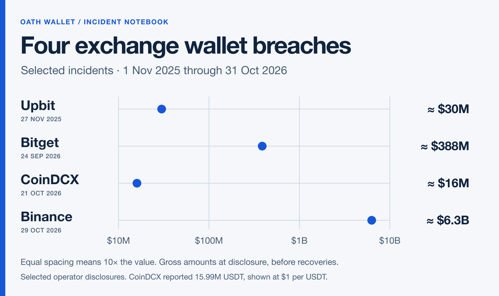
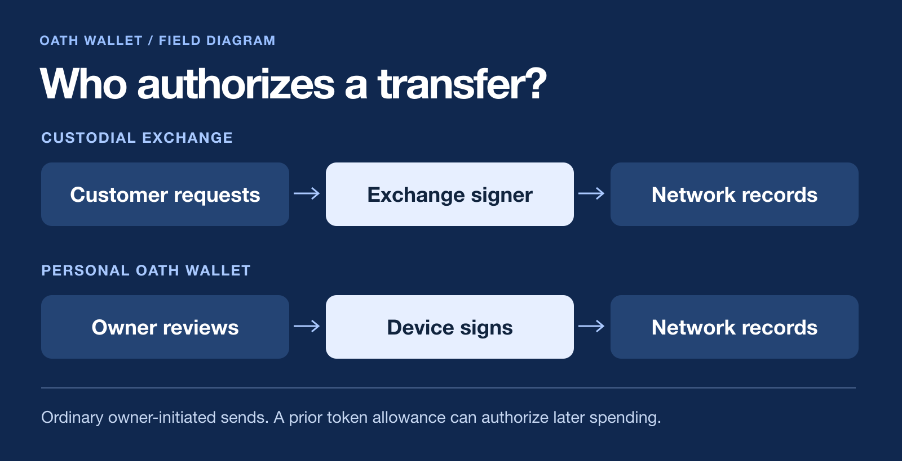

At 20:05 UTC on Thursday, October 29, funds began leaving Binance hot wallets. An XRP holder could have spent the evening with their phone off, their password secret and their two-factor key in a drawer. None of those precautions would have stopped a transfer from a wallet the exchange operated. The customer’s phone was never in that signing path.

Two accounts of the breach matter. Binance can investigate what happened inside its systems. Outside investigators can reconstruct what those systems told blockchains to do. Where the two accounts meet, we learn something practical about keeping money on a phone.

## What the chain can tell us

TRM Labs traced roughly $6.36 billion across ten blockchains. On Ethereum, it found a signed authorization that let one of Binance’s hot wallets run code chosen by the attacker. That code could sweep assets out. Think of the difference between signing one cheque and authorizing someone to write subsequent cheques. On the other nine chains TRM examined, the money moved through ordinary signed transfers. The Ethereum mechanism explains one part of the theft. It cannot explain all ten chains. [TRM’s on-chain reconstruction](https://www.trmlabs.com/resources/blog/north-korea-steals-usd-6-36-billion-from-binance-in-the-largest-hack-in-history)

Who obtained the authority to sign? Binance initially pointed to a possibly compromised engineer’s laptop and access to a service container that could submit withdrawals. Its next bulletin said investigators had found additional points of entry. At that stage the company had found no evidence of leaked wallet private keys. That wording matters. A thief who can persuade a legitimate signer to act may never need a copy of its key. A valid signature alone cannot tell us which computer the attacker first entered. [Binance’s initial account](https://www.binance.com/en-GB/support/announcement/security-incident-update-2026-10-30-c5a8729a97ac486d963784d96c5642d7) · [Its follow-up](https://www.binance.com/en/square/post/382966351297065)

Three figures in the headlines described different things. Binance put the theft at about $6.3 billion. It reported that partners had frozen about $3 billion on-chain. On October 31 it said it had replenished 90% of affected assets, drawing on reserves and company resources. Freezing can stop a thief spending an asset. Replenishing can make customers whole using different assets. Adding those figures would count different stages of the same response. On November 1 Binance announced a phased reopening of withdrawals. [Replenishment update](https://www.binance.bh/en-PH/support/announcement/detail/1fdf1f61559c401da0435895ffcccb62) · [Withdrawal update](https://www.binance.com/en/square/post/383447089416749)

## Four cases from the past twelve months

The chart compares four documented exchange incidents between November 1, 2025 and October 31, 2026. Each dot marks the approximate value moved at the time, before recovery or reimbursement. Equal distances on the scale represent tenfold increases. These cases illustrate different failures. They are a selection, so they cannot tell us how often exchanges are breached.

**Upbit, November 27, 2025.** Solana-based assets worth about ₩44.5 billion, roughly $30 million at the time, went to an unauthorized external address. Upbit’s emergency review identified a wallet weakness that it patched. Finding a weakness during an investigation does not demonstrate the thieves used it. For this case, the transfer and amount are better established than the route in. [Upbit’s notice](https://upbit.com/service_center/notice?id=5803&view=share) · [Contemporaneous reporting](https://www.bloomberg.com/news/articles/2025-11-27/crypto-exchange-upbit-hit-by-exploit-after-10-3-billion-deal)

**Bitget, September 24, 2026.** Here the operator gave a much more specific account. An attacker exploited a flaw in a third-party security product, obtained powerful internal credentials, then issued fraudulent withdrawal commands. Twelve hot or warm wallet addresses were affected. Bitget ultimately put the value at about $388 million. Its timeline records 34 minutes between the first abnormal transfer and the reconciliation alarm that blocked withdrawals. Customer login security could do little about an instruction that already looked internal. [Bitget’s investigation and timeline](https://www.bitget.com/academy/bitget-security-incident-what-happened-timeline-impact-response)

**CoinDCX, October 21, 2026, disclosed in detail October 25.** An old deposit address kept receiving money after the exchange retired it. CoinDCX continued crediting customers and ran a service to sweep those funds into current wallets. When the sweeper stopped working for a period, deposits accumulated at an address on previously compromised infrastructure. CoinDCX says it absorbed a loss of 15.99 million USDT. A retired address can disappear from an app while remaining perfectly capable of receiving money on-chain. [CoinDCX’s account](https://coindcx.com/blog/coindcx-news/on-chain-wallet-activity-update-21-oct-2026)

**Binance, October 29, 2026.** The fourth dot is so far from the others that it helps to put it in words. Binance’s initial $6.3 billion estimate was about sixteen times Bitget’s $388 million. The size tells us how much one signing environment could reach. It tells us very little about an individual customer’s password habits.

## Move the signer, and the risk moves with it

Open an exchange app and tap Withdraw. You ask a company to move funds. It can inspect your request, pause it during an incident, replace missing assets from its treasury, or deny the withdrawal. Open a personal software wallet and tap Send. The usual path is shorter. Your device prepares and signs a transaction, then a network provider broadcasts it. There is no exchange withdrawal desk in that path.

We publish Oath Wallet, so you should be able to check our side of that comparison. The public iPhone and iPad wallet stores recovery material in an encrypted local vault and signs on the device. The application source for version 4.1.15, build 100, is public under the MIT license. Take one concrete path through it. Before signing an ordinary Ethereum-family send, the code checks that the account belongs to the wallet, the network matches the plan, and the sender is the expected address. The network receives a signed transaction. It does not need the recovery phrase to relay it. [Read the release source](https://github.com/devdasx/oath-wallet/tree/c7cdbde5e9f136b595500e92fbc904b107dcd8ee) · [Inspect the signing function](https://github.com/devdasx/oath-wallet/blob/c7cdbde5e9f136b595500e92fbc904b107dcd8ee/OathAtmosphere/Wallet/OathEVMSigning.swift)

For someone holding their own keys, that changes two things at once. Oath has no company withdrawal key for that personal wallet. Oath support also cannot replace a lost recovery secret. A deliberate export or an optional encrypted iCloud backup creates another copy to protect. An imported phrase carries its history with it. If somebody copied it before you installed Oath, installing a new wallet does not revoke their copy. The public review records tested fixes and remaining gaps so readers can judge the evidence themselves. [Public build and backup behavior](https://github.com/devdasx/oath-wallet/blob/c7cdbde5e9f136b595500e92fbc904b107dcd8ee/Documentation/PublicBuild.md) · [Review evidence](https://github.com/devdasx/oath-wallet-security-review)

## The signature that never asks for your words

Suppose a site offers to check whether you qualify for a refund. It opens your wallet. The screen shows a token approval with a spender address and a very large limit. If you approve it, that spender may later transfer those tokens within the allowance. Your recovery phrase can stay on paper in a locked drawer the entire time. This familiar token allowance is a different permission from the account delegation seen in the Binance case, but it makes the same point in everyday terms. The words you keep secret and the instructions you sign protect different things. [How ERC-20 allowances work](https://eips.ethereum.org/EIPS/eip-20)

If you encounter that screen, read the verb first. Sending pays a recipient. Approving gives a spender an allowance. Delegating can give code authority over an account. Then read the network, asset, address and amount. If you came to check a balance and the request grants spending rights, close it. If you already granted a token allowance, disconnecting a site does not revoke the on-chain permission.

There is a quieter test of custody than any promise on a wallet’s home page. Imagine the company’s withdrawal service goes offline tonight. Could you still use your recovery material in compatible software to send your funds tomorrow? Then ask the reverse question. If your phone and every usable backup disappeared tonight, who could restore access for you? Those two answers tell you where your money’s real dependencies live.
