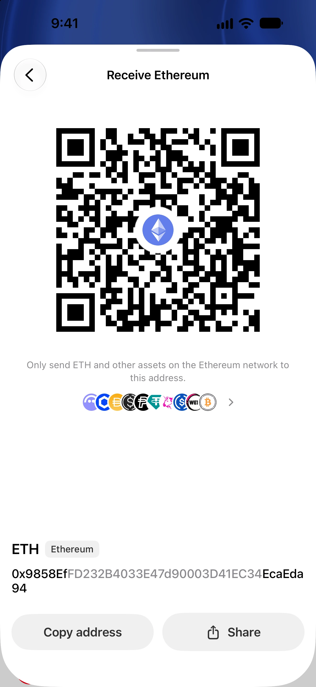

You can use a compatible Trust Wallet recovery phrase in Oath without sending your coins anywhere. Oath derives the supported accounts from the same recovery material. The assets stay on their original networks, and Trust Wallet can still access them.

This guide covers the account conventions below in Oath 5.0.2 (104). It does not promise that every wallet, account or asset shown in Trust Wallet will appear in Oath.

## Check your starting wallet

Use this route for a software wallet whose original BIP39 recovery phrase you control. A wallet you previously imported into Trust Wallet may follow another application's account rules. Its presence in Trust Wallet does not change those rules.

A watch-only address does not contain signing keys. A hardware-connected account belongs to the hardware wallet; keep its recovery phrase on the hardware recovery route. A Trust Wallet cloud backup file is not an Oath backup file.

Never enter recovery words or private keys into this website, a support conversation or an online conversion tool. Enter them only in the wallet app's import screen on your own device.

## Verified account compatibility

The paths below identify account zero and, where applicable, its first receiving address. They are a technical reference, not text to enter into the recovery-phrase field.

| Starting account | Oath recovery scope | What to check |
| --- | --- | --- |
| Ethereum and ordinary EVM accounts | The first account at `m/44'/60'/0'/0/0`, on Oath's enabled EVM networks | Compare the full address and the exact network. An identical address does not bridge funds. |
| Bitcoin Native SegWit | Account zero at `m/84'/0'/0'`, including receiving and change branches | Match a known address and address type. This is BTC, not BCH or a wrapped Bitcoin token. |
| TRON | The first account at `m/44'/195'/0'/0/0` | Compare the TRON address. TRC20 assets remain on TRON. |
| Solana using Trust Wallet's convention | Account zero at `m/44'/501'/0'` | In Oath, choose the Trust Wallet address path in Solana Receive. The default Phantom path gives a different address. |

Other networks and non-default account indexes are outside this guide's verified scope. Check the [supported networks](https://oathwallet.org/networks) and the original account details before relying on recovery. The [token catalog](https://oathwallet.org/tokens) describes discovery entries; inclusion does not prove that every token action has been tested.

## Import the recovery phrase

1. In Trust Wallet, identify the wallet and record its public receiving addresses for the networks you use. Use its own recovery instructions to access your original backup. Keep the original wallet available.
2. Open Oath and choose **Import wallet**. If Oath already contains a wallet, open **Settings → Wallets** and choose the import action.
3. Enter the original recovery words in order. Use the BIP39 format for this guide if Oath asks you to choose a format. Do not replace words or translate them.
4. Complete Oath's setup and choose a recognizable wallet name. If the original wallet used an additional BIP39 passphrase, restore that exact passphrase wallet before checking its addresses. The app unlock password is a different thing; see the [passphrase guide](https://articles.oathwallet.org/add-bip39-passphrase-oath-wallet).
5. Open Receive for each original network and compare the full public address. For Solana, open the address-path control in Receive and choose **Trust Wallet**, then return to the asset screen. See the [Solana path instructions](https://help.oathwallet.org/articles/solana-address-path).
6. Allow supported balances and history to refresh. Confirm each account separately before relying on it for receiving or sending.

For the basic import controls, see [Import a recovery phrase](https://help.oathwallet.org/articles/import-recovery-phrase). Changing the Solana path selects a different account from the same phrase; it does not transfer SOL or tokens between those accounts.

## Which assets and settings carry over?

At a matching address, native coins and tokens remain owned by the same on-chain account. Oath can display and operate on supported assets according to that network's capabilities. Check a token's network and contract or mint, rather than its symbol alone. ETH on Base and ETH on Ethereum are separate balances.

Custom token lists, account labels, contacts, notification settings and connected dApp sessions are app settings; this phrase import does not copy them. Existing on-chain approvals remain in force. Importing also does not withdraw staking positions, close DeFi positions or guarantee that an NFT or position is visible in Oath. Keep the original interface available for anything outside Oath's supported scope.

Import itself is not an on-chain transaction and has no network fee. Sending later requires the relevant network's fee asset or resources. Check the fee shown in Oath before confirming.

## If an address or balance is different

A valid phrase can still open the wrong account. Check the selected wallet, original language and word order, any additional passphrase, account index and address path. On Solana, check the Trust Wallet path first. For Bitcoin, compare a known historical address: a wallet can show a new receiving address while still belonging to the same account.

If the address matches but a token is missing, check its exact network, contract or mint and Oath's available discovery and send capabilities. An empty screen does not prove the funds are gone. Do not send more funds to test an unexplained address mismatch or remove your original recovery copy.

## Moving to a new recovery phrase instead

Importing keeps the same keys. If you want a wallet with new keys, create a new wallet in Oath, back it up, verify its receiving address and transfer each supported asset on the correct network. That is a separate on-chain operation with fees. A small transfer first can confirm the destination before a larger one. Importing a compromised phrase does not make it safe again.

## What we verified

Checked November 6, 2026 against [Oath 5.0.2 (104) source](https://github.com/OathWallet/oath-wallet/tree/7ffd0f449c3312d9fafd01eda59c6b9eb813f9ca). We compared the released account paths with [Trust Wallet Core 4.8.4's registry](https://github.com/trustwallet/wallet-core/blob/4.8.4/registry.json), ran public address vectors with that version's host library, and checked Oath's [Solana path selection](https://github.com/OathWallet/oath-wallet/blob/7ffd0f449c3312d9fafd01eda59c6b9eb813f9ca/Packages/OathDatabase/Sources/OathDatabase/SolanaReceive.swift). These checks establish the stated derivation compatibility, not a live transfer test or a test of every Trust Wallet release.

[Get Oath for iPhone](https://apps.apple.com/us/app/oath-bitcoin-crypto-wallet/id6780187283) · [Use a MetaMask wallet in Oath](https://articles.oathwallet.org/use-metamask-wallet-in-oath) · [Restore an Electrum Bitcoin wallet](https://articles.oathwallet.org/restore-electrum-bitcoin-wallet-on-iphone)

## Check the account in Oath

Oath 4.0.3 app screenshot with sample data. Compare the network and full receiving address in the app. This older capture illustrates Receive; it does not show a completed migration.

## After checking compatibility

- [Solana account and transfer guidance](https://oathwallet.org/networks/solana)
- [Choose the network for USDT or USDC](https://oathwallet.org/networks/choose-token-network)
- [Find the network fee asset](https://oathwallet.org/networks/fees)
- [Read current release information](https://articles.oathwallet.org/oath-wallet-release-history)
